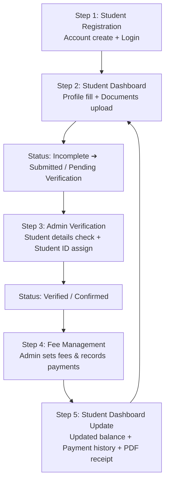

# 📋 मा नर्मदा आध्यात्मिक शिक्षण संस्था — अंतिम कार्ययोजना व क्लायंट आवश्यकता (Updated Client Requirements)

---

## 📌 कार्यकारी सारांश (Executive Summary)
सध्याची चालू सार्वजनिक वेबसाइट (Public Website) तशीच अबाधित ठेवून, त्यावर **विद्यार्थी पोर्टल (Student Portal)** व **प्रशासक नियंत्रण (Admin Dashboard)** ही नवीन सुरक्षित प्रणाली जोडली जात आहे.

---

## 1. 🎓 विद्यार्थी नोंदणी व लॉगिन (Student Registration & Login)

- **नोंदणी (Sign Up / Register):**
  - विद्यार्थी वेबसाइटवर जाऊन थेट नवीन खाते नोंदवू शकेल.
  - नोंदणी करताना: **नाव (Full Name), मोबाईल क्रमांक (Mobile Number), ई-मेल (Email) आणि पासवर्ड (Password)** भरेल.
- **सुरक्षित लॉगिन (Login):**
  - लॉगिन पानावर **Email किंवा Mobile Number + Password** टाकून लॉगिन करता येईल.
- **पासवर्ड विसरल्यास (Forgot Password):**
  - लॉगिन पानावर **"Forgot Password"** पर्याय असेल.
  - याद्वारे सुरक्षित OTP किंवा ईमेल रिसेट लिंकद्वारे (Reset Link) पासवर्ड रिसेट करता येईल.
- **डॅशबोर्ड प्रवेश (Navigation):**
  - लॉगिन झाल्यानंतर नेव्हिगेशन बार (Navbar) किंवा प्रोफाइल मेनूमध्ये **"Student Dashboard"** पर्याय दिसेल.

---

## 2. 👤 विद्यार्थी डॅशबोर्ड व प्रोफाईल (Student Dashboard & Profile)

विद्यार्थी लॉगिन झाल्यानंतर त्याला स्वतःची प्रोफाईल तयार (Create) व अपडेट (Update) करता येईल:

### 📝 विद्यार्थ्याने भरावयाची सविस्तर माहिती (Student Fillable Information):

1. **Personal Information (वैयक्तिक माहिती):**
   - **Full Name** — विद्यार्थ्याचे पूर्ण नाव
   - **Date of Birth** — जन्मतारीख
   - **Student Photo** — विद्यार्थ्याचा फोटो (पासपोर्ट साईझ)
   - **Blood Group** — रक्तगट
   - **Gender** — लिंग *(पर्यायी / Optional field)*
2. **Parent / Guardian Information (पालक माहिती):**
   - **Father’s / Mother’s Name** — पालकांचे नाव
   - **Parent’s Mobile Number** — पालकांचा मोबाईल नंबर
   - **Alternative Mobile Number** — पर्यायी मोबाईल नंबर
3. **Address Information (पत्ता माहिती):**
   - **Full Address** — पूर्ण पत्ता
   - **Village** — गाव
   - **Taluka** — तालुका
   - **District** — जिल्हा
4. **Educational Information (शैक्षणिक माहिती):**
   - **School Name** — शाळेचे नाव
   - **School Information** — शाळेची इतर माहिती
   - **Class / Course** — वर्ग किंवा अभ्यासक्रम
5. **Admission Information (प्रवेश माहिती):**
   - **Admission Date** — प्रवेश दिनांक
   - **Student ID / Admission Number** — विद्यार्थी ID / प्रवेश क्रमांक *(हा क्रमांक ॲडमिन पडताळणीनंतर अधिकृतपणे assign करेल)*
- **आवश्यक ८ कागदपत्रे अपलोड (Upload 8 Mandatory/Required Documents):**
  1. आधार कार्ड (Aadhaar Card)
  2. पॅन कार्ड (PAN Card)
  3. जन्म प्रमाणपत्र (Birth Certificate)
  4. शाळेची कागदपत्रे (School Documents — गुणपत्रिका/बोनाफाईड)
  5. मागील शाळेचा दाखला (Previous School Leaving Certificate — LC/TC)
  6. विद्यार्थ्याचा फोटो (Student Photo — पासपोर्ट साईझ)
  7. पालकांची कागदपत्रे (Parent Documents — ओळखपत्र/पत्ता)
  8. इतर आवश्यक प्रमाणपत्रे (Other Required Certificates — उदा. जात, उत्पन्न दाखला)
- **प्रोफाईल स्थिती (Profile Status):**
  - `Incomplete` (अपूर्ण) ➔ `Submitted / Pending Verification` (पडताळणी प्रलंबित) ➔ `Verified / Confirmed` (प्रमाणित प्रवेश).
- **शुल्क सारांश (Fees Summary):**
  - एकूण फी (Total Fees), भरलेली फी (Paid Fees), शिल्लक फी (Remaining Fees), पुढील देय तारीख (Next Due Date).
- **पेमेंट इतिहास व पावती (Payment History & Receipts):**
  - जुन्या सर्व पेमेंटचा इतिहास पाहणे आणि अधिकृत फी पावती (Download Fee Receipt / PDF) डाऊनलोड करणे.

---

## 3. 🖥️ प्रशासक डॅशबोर्ड (Admin Dashboard)

संस्थेच्या ॲडमिनसाठी स्वतंत्र, सुरक्षित व्यवस्थापन पॅनेल:

- **विद्यार्थी शोध (Search):**
  - विद्यार्थ्याचे नाव किंवा **Student ID / Admission Number** टाकून त्वरित शोध घेणे.
- **प्रोफाईल व कागदपत्रे पाहणे (View Profile & Documents):**
  - विद्यार्थ्याने भरलेली माहिती व अपलोड केलेली सर्व कागदपत्रे तपासणे.
- **माहिती पडताळणी व दुरुस्ती (Verify & Update):**
  - माहिती व कागदपत्रे योग्य असल्यास पडताळणी (Verify) करणे आणि आवश्यक असल्यास माहिती अपडेट करणे.
- **विद्यार्थी आयडी वाटप (Assign Student ID):**
  - कागदपत्रे तपासून विद्यार्थ्याला अधिकृत **Student ID / Admission Number** प्रदान करणे.
- **शुल्क व हप्ते निश्चिती (Set Fees & Schedule):**
  - प्रत्येक विद्यार्थ्यासाठी एकूण फी व हप्ते (Payment Schedule) ठरवणे.
- **पेमेंट नोंदणी (Record Payment):**
  - प्रत्यक्ष अथवा ऑनलाईन फी जमा झाल्यावर तारीख, पावती क्रमांक व रक्कम नोंदवणे.
- **शिल्लक फी ऑटो-कॅल्क्युलेशन (Automatic Balance Calculation):**
  - भरलेली रक्कम वजा होऊन शिल्लक फी आपोआप गणना होणे.
- **पावती तयार करणे (Generate Receipt):**
  - डिजिटल फी पावती जनरेट करणे, जी विद्यार्थ्याला त्याच्या डॅशबोर्डमध्ये त्वरित डाऊनलोडसाठी उपलब्ध होईल.

---

## 4. 🔄 संपूर्ण कार्यपद्धती (Complete Workflow)

---

## 5. 🔒 महत्त्वाचा सुरक्षा व गोपनीयता नियम (Crucial Security & Data Isolation)

1. **तात्काळ ॲक्सेस बंदी (No Direct Verified Access):**
   - विद्यार्थ्याने स्वतः नोंदणी केली तरी त्याला लगेच अधिकृत प्रवेश (Verified Student Access) मिळणार नाही.
   - नोंदणी व फॉर्म भरल्यानंतर त्याची प्रोफाईल **"Pending Verification"** मध्ये राहील.
   - ॲडमिनने कागदपत्रे तपासून मान्यता दिल्यानंतरच **Student ID** व प्रवेश कन्फर्म होईल.
2. **डेटा आयसोलेशन व गोपनीयता (Strict Data Privacy):**
   - ॲडमिनला सर्व विद्यार्थ्यांचा डेटा पाहण्याचा व व्यवस्थापित करण्याचा अधिकार असेल.
   - **विद्यार्थ्याला फक्त आणि फक्त स्वतःचीच माहिती व फी दिसेल.** इतर कोणत्याही विद्यार्थ्याचा डेटा पाहता येणार नाही.
3. **पासवर्ड सुरक्षितता (Authentication & Password Security):**
   - पासवर्ड कधीही प्लेन टेक्स्ट (Plain Text) मध्ये साठवला जाणार नाही; सुरक्षित हॅशिंग (Bcrypt) द्वारे कूटबद्ध राहील.
   - Forgot Password साठी सुरक्षित टाइम-बाउंड OTP किंवा ईमेल पासवर्ड रिसेट लिंक वापरली जाईल.
4. **वेबसाइट अखंडता (Website Integrity):**
   - सध्याची सुंदर सार्वजनिक वेबसाइट तशीच सुरू राहील; त्यामध्ये अखंडितपणे विद्यार्थी लॉगिन/नोंदणी आणि डॅशबोर्ड लिंक जोडली जाईल.

---

## 6. 🛠️ तांत्रिक घटक (Technical Architecture)

- **Frontend:** React, TanStack Router, Tailwind CSS, Lucide Icons.
- **Pages & Routes:**
  - Public Website (होम, संस्था, गुरुकुल, उपक्रम, संपर्क)
  - `/login` (Sign In / Register / Forgot Password OTP)
  - `/student/dashboard` (Personal info, Academic info, Document upload, Fee cards, Receipts)
  - `/admin/students` (Search, Verify, Assign Student ID, Fee tracking, Record payment)
- **Backend:** Node.js, Express, MongoDB.
- **Security:** JWT Authentication, Bcrypt Password Hashing, Role-Based Access Control (Admin vs. Student).
